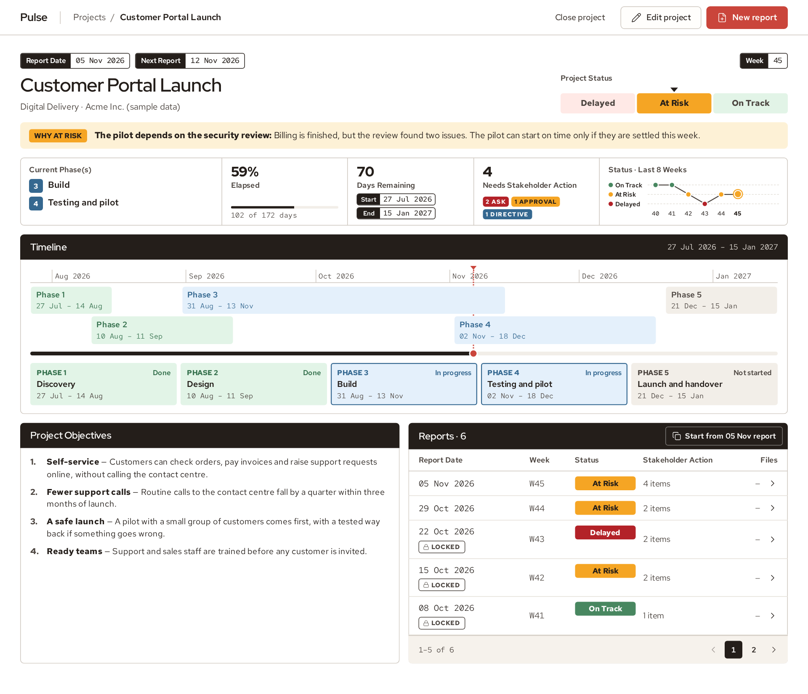
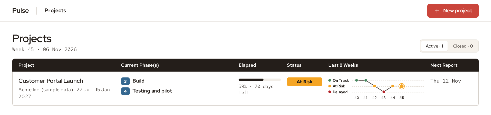
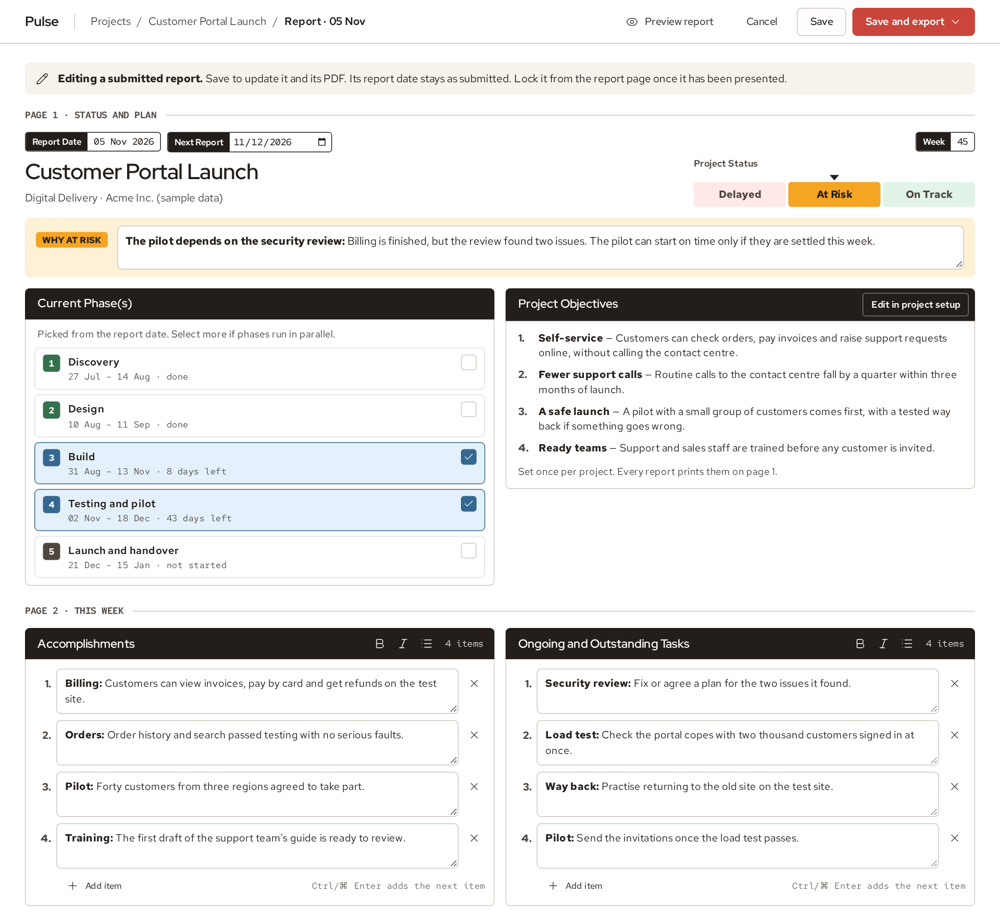
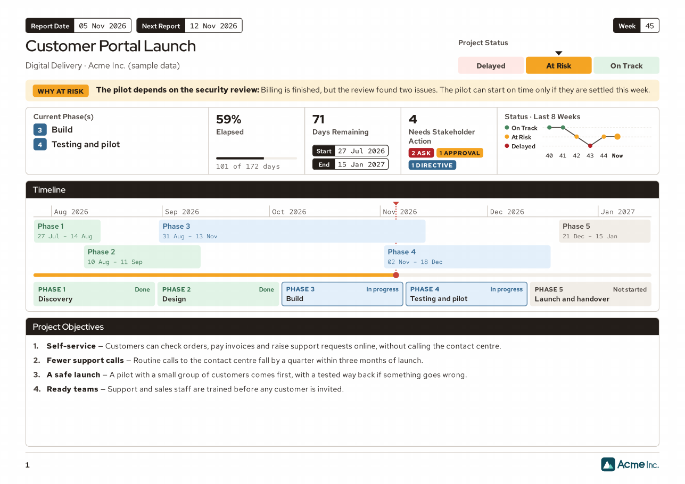
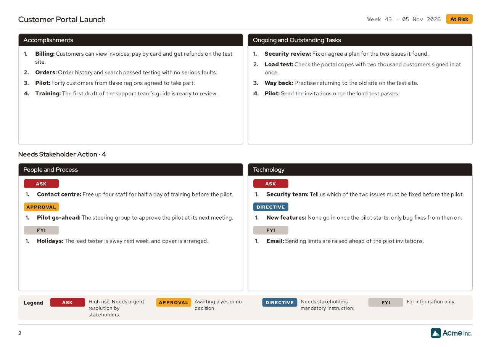

# Open Project Pulse

Pulse keeps a list of your projects and turns a few minutes of typing each week
into a two-page status report for stakeholders, as a PDF or as slides. It runs
on your own computer, and your projects and reports stay there.



## Install

<!-- The install commands must stay on one line, to copy and paste. -->
<!-- markdownlint-disable MD013 -->

On **Windows**, open PowerShell and run:

```powershell
powershell -ExecutionPolicy ByPass -c "[Net.ServicePointManager]::SecurityProtocol = 'Tls12'; irm https://raw.githubusercontent.com/antonysallas/open-project-pulse/main/install.ps1 | iex"
```

On **macOS or Linux**, open a terminal and run:

```bash
curl -LsSf https://raw.githubusercontent.com/antonysallas/open-project-pulse/main/install.sh | sh
```

<!-- markdownlint-enable MD013 -->

You don't need admin rights or anything installed first. To see what the
installer does, or to read it before you run it, see
[Installing Pulse](docs/install.md).

## Start

Open a new terminal window and run:

```text
pulse
```

Pulse opens in your browser at <http://localhost:4070>. Leave the terminal open
while you use it, and press Ctrl-C there to stop it. On Windows, answer `Y` if it
asks whether to end the batch job.

## Try the sample project

A new install comes with a project to look at: **Customer Portal Launch** for
**Acme Inc.**, with six weekly reports and a logo. Open a report, export it, edit
it: nothing depends on it. Acme Inc. is made up, and so is everything in the
project. The dates are set when it is added, so the latest report is always from
the past week.

When you have seen enough, remove it, then click **New project** to start on your
own:

```text
pulse sample --remove
```

That removes the sample project, its reports and the Acme logo, and nothing else.
Updates never add it back, but `pulse sample` does.

## What it looks like

All your projects in one table, with each one's status over the last eight weeks:



One page to write the week's report, in the same order as the report:



A two-page report for stakeholders, to export as a PDF or as slides:





## What it does

- **Status at a glance:** On Track, At Risk or Delayed, with the reason, the time
  elapsed and a graph of the last eight weeks.
- **Phases or sprints:** a timeline for either, and phases can overlap.
- **Stakeholder actions:** items typed Ask, Approval, Directive or FYI, counted
  on the report.
- **Export:** PDF and PowerPoint.
- **Drafts:** a report is kept as you type, so a closed tab loses nothing.
- **Lock:** once you have presented a report, lock it so that it can't change.

[Everything Pulse does](docs/features.md) has the details.

## Add your logo

To put your organisation's logo on your reports, in place of the Acme one:

```text
pulse logo path/to/logo.svg
```

Use an SVG (with `width` and `height` on its `<svg>` tag) or a PNG, then reload
the page. It shows in the footer of every report, next to the customer's logo,
which you add to each project in its form. Check that you are allowed to use a
logo before you add it.

## Commands

| Command                 | What it does                                  |
|:------------------------|:----------------------------------------------|
| `pulse`                 | Start Pulse and open it in your browser       |
| `pulse --port 5000`     | Use another port (or set `PULSE_PORT`)        |
| `pulse --data DIR`      | Use another data folder (or set `PULSE_DATA`) |
| `pulse --no-open`       | Don't open the browser                        |
| `pulse logo FILE`       | Put your organisation's logo on reports       |
| `pulse logo --remove`   | Take it off                                   |
| `pulse sample --remove` | Remove the made-up project and its logo       |
| `pulse sample`          | Add them back                                 |
| `pulse update`          | Install the latest version; your data stays   |
| `pulse uninstall`       | Remove Pulse; your data stays                 |
| `pulse version`         | Show the installed version                    |

## Your data

Your data is plain files in your user folder. To back it up, copy the folder.

- Windows: `%LOCALAPPDATA%\open-project-pulse\data`
- macOS and Linux: `~/.local/share/open-project-pulse/data`

Nothing leaves your computer. Pulse is made for one person on their own
computer: it listens only on that computer, and it has no sign-in unless you
[turn one on](docs/sign-in.md).

## Learn more

- [Installing Pulse](docs/install.md): what the installer does, and its settings
- [Everything Pulse does](docs/features.md)
- [File formats and server API](docs/reference.md)
- [Optional sign-in](docs/sign-in.md): to share Pulse behind a sign-in proxy
- [Development](docs/development.md): build, test and release

## Licence

GPL-3.0: see [LICENSE](LICENSE). Some bundled parts have their own licences:

- The Sallas design tokens and components in `src/styles/sallas` are under the
  MIT License: see `src/styles/sallas/LICENSE`.
- The Red Hat fonts are under the SIL Open Font License: see
  `src/styles/redhat/RED-HAT-FONTS-LICENSE.txt`.
- The sample project and the Acme logo in `sample/` were made for Pulse and are
  dedicated to the public domain under
  [CC0 1.0](https://creativecommons.org/publicdomain/zero/1.0/). Use them as you
  like. "Acme Inc." is a made-up name, and the sample is not connected with any
  real company of that name.
